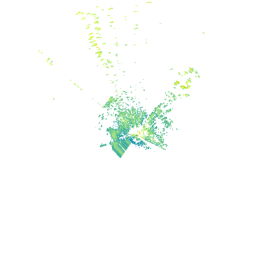
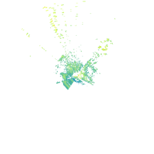
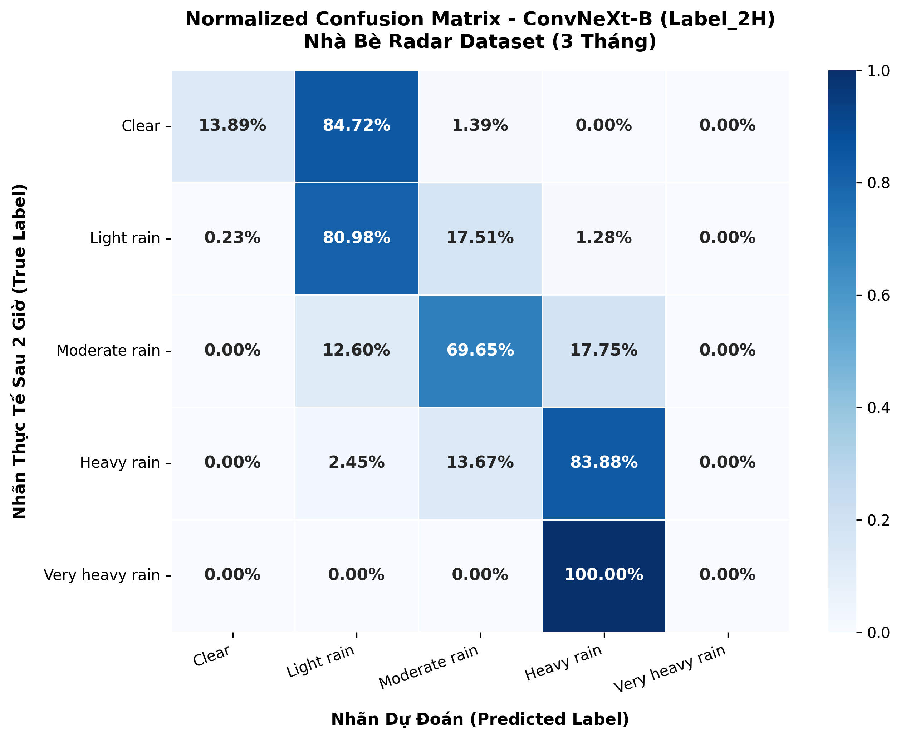

# 🌧️ Radar Rainfall Nowcasting: Phân Loại Trạng Thái Mưa Hạn Cực Ngắn Từ Dữ Liệu Radar Thời Tiết Nhà Bè

[](https://www.python.org/)
[](https://pytorch.org/)
[](https://github.com/huggingface/pytorch-image-models)
[](https://opensource.org/licenses/MIT)

> **Đồ án cơ sở ngành Khoa học Dữ liệu — Khoa Khoa học & Kỹ thuật Máy tính**  
> **Trường Đại học Bách Khoa — ĐHQG-HCM** (Học kỳ 1, Năm học 2026–2027)

---

## 📌 Thông Tin Đề Tài & Nhóm Tác Giả
* **Chủ đề 12:** Phân loại trạng thái mưa và cảnh báo hạn cực ngắn từ dữ liệu radar thời tiết Nhà Bè.
* **Sinh viên thực hiện:** Nguyễn Huỳnh Lâm — **MSSV:** 2411841
* **Giảng viên hướng dẫn:** 
  * ThS. Lê Đình Quyết (Đài Khí tượng Thủy văn Khu vực Nam Bộ)
  * ThS. Nguyễn Văn Gia Thịnh (Trường ĐH Bách Khoa - ĐHQG-HCM)
* **Bài báo tham chiếu chính:** Le Hong Trang, Nguyen Hoang Anh Thu, Nguyen Minh Dan, Nguyen Hoang Hoang, Pham Tan An, Phan Thanh Vu (2025). *Radar Image Classification for Rainfall Nowcasting*, SSRN Preprint, doi: [10.2139/ssrn.5139080](https://doi.org/10.2139/ssrn.5139080).

---

## 🚀 Giới Thiệu & Động Lực Nghiên Cứu
Dự báo mưa hạn cực ngắn (**Rainfall Nowcasting**, trong khung thời gian 0–3 giờ) đóng vai trò sống còn trong việc cảnh báo sớm ngập úng đô thị và điều tiết giao thông tại TP. Hồ Chí Minh và khu vực Nam Bộ.

Các nghiên cứu sinh chuỗi ảnh tương lai (như ConvLSTM, TrajGRU) thường gặp nhược điểm: ảnh sau 1–2 giờ bị mờ nhòe (blurry) và chi phí GPU rất lớn. Đề tài tiếp cận bài toán dưới dạng **Phân loại ảnh radar Sweep 0** tại thời điểm hiện tại $T_0$ sang **5 cấp độ thời tiết sau 2 giờ ($T_0 + 2h$)**:
1. **Clear** ($< 30\text{ dBZ}$): Quang đãng / Không mưa
2. **Light rain** ($30 - 40\text{ dBZ}$): Mưa nhỏ lác đác
3. **Moderate rain** ($40 - 47.5\text{ dBZ}$): Mưa vừa diện rộng
4. **Heavy rain** ($47.5 - 55\text{ dBZ}$): Mưa to (nguy cơ ngập úng đô thị)
5. **Very heavy rain** ($\ge 55\text{ dBZ}$): Dông bão / Mưa rất to nguy hiểm

<p align="center">
  
  &nbsp;&nbsp;&nbsp;&nbsp;
  
  <br/>
  <em>Hình 1: Ảnh radar PPI nguyên bản (trái) và ảnh chuẩn hóa 224 &times; 224 pixel góc Sweep 0 (phải).</em>
</p>

---

## 💡 Đóng Góp Kỹ Thuật Nổi Bật
1. **Quy mô dữ liệu thực nghiệm 3 tháng:** Xử lý gần 30.000 file RAW trạm Nhà Bè trong 3 tháng mùa mưa cao điểm (Tháng 6, 7, 8 năm 2025), thu được **26.405 lượt quét hợp lệ** (gấp 3 lần quy mô thông thường), giúp triệt tiêu hoàn toàn nguy cơ học vẹt (overfitting).
2. **Trọng số mũ nghịch đảo tần suất:** Áp dụng công thức $w_i = 10^{100(1-p_i)}$ để tính độ phản hồi trung bình $\bar{Z}$, đảm bảo các vùng dông bão đỏ rực (chỉ chiếm 3–5% diện tích) không bị triệt tiêu bởi 95% diện tích trời quang.
3. **Time-Shifting thời gian thực (`pd.merge_asof`):** Khắc phục chu kỳ quét thực tế dao động 3–7–3 phút của radar Nhà Bè với dung sai $\le 5$ phút.
4. **Phân tầng Stratified Split 80 : 10 : 10:** Bảo toàn nguyên vẹn tỷ lệ phân bố của 90 mẫu bão lớn hiếm gặp ($0.3\%$) đồng đều trên cả 3 tập (Train: 72, Val: 9, Test: 9).
5. **Mạng tích chập ConvNeXt-Base kết hợp Focal Loss ($\gamma = 2.0$):**
   * Tận dụng trọng số **ImageNet-22K** (14 triệu ảnh) để nhận diện hình thái xoáy dông.
   * Focal Loss tự động triệt tiêu gradient của các ca mưa nhỏ dễ đoán, ép mô hình dồn toàn bộ trọng tâm nơ-ron học các ca mây dông nguy hiểm.

---

## 📊 Kết Quả Thực Nghiệm Trên Tập Kiểm Thử Độc Lập (Test Set)

Trên tập kiểm thử gồm **2.634 mẫu độc lập** (chưa từng xuất hiện trong quá trình huấn luyện):
* **Độ chính xác tổng thể (Test Accuracy):** **76.23%** (Val Acc: 76.91% $\rightarrow$ Độ lệch $< 0.7\%$, **hoàn toàn không overfitting**).
* **Độ nhạy bắt trúng Mưa to (Heavy Rain Recall):** **83.88%** (Precision: 72.36%, F1-Score: 77.69%).
* **Weighted F1-Score:** **75.76%** (Macro F1: 50.23% trên cả 5 lớp).

### Bảng đánh giá chi tiết:
| Cấp độ thời tiết | Precision | Recall | F1-Score | Số lượng mẫu (Support) |
| :--- | :---: | :---: | :---: | :---: |
| **Clear** | 76.92% | 13.89% | 23.53% | 72 |
| **Light rain** | 86.60% | 80.98% | 83.70% | 1.325 |
| **Moderate rain** | 63.14% | 69.65% | 66.24% | 738 |
| **Heavy rain (Mưa to)** | **72.36%** | **83.88%** | **77.69%** | **490** |
| **Very heavy rain** | 0.00% | 0.00% | 0.00% | 9 |
| **Accuracy Tổng thể** | \multicolumn{3}{c}{\textbf{76.23%}} | **2.634** |
| **Weighted Average** | **76.82%** | **76.23%** | **75.76%** | **2.634** |

<p align="center">
  
  <br/>
  <em>Hình 2: Ma trận nhầm lẫn chuẩn hóa của mô hình ConvNeXt-B tại mốc dự báo 2 giờ (T+2h).</em>
</p>

> **Phân tích Ma trận nhầm lẫn:**
> * **100% bão lớn (9/9 mẫu) được dự báo vào lớp liền kề là Heavy rain (Mưa to):** Trong nghiệp vụ cảnh báo thiên tai, việc cảnh báo mưa to vẫn kích hoạt đầy đủ máy bơm chống ngập, không để xảy ra bị động.
> * **Tuân thủ tính liên tục vật lý:** Toàn bộ sai số chỉ nằm ở các ô sát đường chéo chính (giữa hai cấp mưa liền kề), không có sai số nhảy vọt (như Quang đãng đoán thành Bão).

---

## 📁 Cấu Trúc Thư Mục Repository

```text
Radar_Nowcasting_Repo/
├── 01_Preprocessing_and_Labeling/        # Trích xuất dBZ & Gán nhãn 3 tháng
│   ├── extract_and_label_thang6.py       # Script xử lý Tháng 6/2025
│   ├── extract_and_label_thang7.py       # Script xử lý Tháng 7/2025
│   └── extract_and_label_thang8.py       # Script xử lý Tháng 8/2025
├── 02_Dataset_Preparation/               # Chuẩn hóa & Chia tập
│   ├── standardize_and_stratified_split.py # Time-shifting merge_asof & Stratified Split
│   └── export_radar_images_224.py        # Trích xuất ảnh PPI 224x224 đa tiến trình
├── 03_Model_Pipeline/                    # Huấn luyện & Đánh giá mô hình
│   ├── radar_dataset.py                  # PyTorch Dataset & Data Augmentation
│   ├── focal_loss.py                     # Focal Loss with Label Smoothing
│   ├── train_convnext.py                 # Training Loop FP16 AMP + AdamW
│   └── evaluate_test_set.py              # Đánh giá độc lập trên Test Set & Vẽ Heatmap
├── assets/                               # Hình ảnh biểu đồ và công thức toán học
│   ├── radar_clean.png
│   ├── radar_224x224.png
│   ├── confusion_matrix_2h.png
│   ├── formula_weight.png
│   └── formula_focal_loss.png
├── requirements.txt                      # Danh sách thư viện phụ thuộc
├── .gitignore
└── README.md                             # Tài liệu tổng quan đề tài
```

---

## 🛠️ Hướng Dẫn Cài Đặt & Sử Dụng

### 1. Cài đặt môi trường
```bash
git clone https://github.com/<your-username>/Radar-Nowcasting-NhaBe.git
cd Radar-Nowcasting-NhaBe
pip install -r requirements.txt
```

### 2. Tiền xử lý dữ liệu & Chia tập Stratified
```bash
# Bước 1: Ghép nhãn tương lai và chia tập 80/10/10
python 02_Dataset_Preparation/standardize_and_stratified_split.py

# Bước 2: Trích xuất ảnh PPI 224x224 từ file RAW
python 02_Dataset_Preparation/export_radar_images_224.py
```

### 3. Huấn luyện mô hình ConvNeXt-B
```bash
python 03_Model_Pipeline/train_convnext.py
```

### 4. Đánh giá trên tập kiểm thử độc lập
```bash
python 03_Model_Pipeline/evaluate_test_set.py
```

---

## 📜 Trích Dẫn & Bản Quyền
Mã nguồn được phát triển phục vụ mục đích nghiên cứu học thuật trong khuôn khổ Đồ án cơ sở ngành Khoa học Dữ liệu, Trường ĐH Bách Khoa — ĐHQG-HCM. Giấy phép phân phối mã nguồn mở theo [MIT License](LICENSE).
